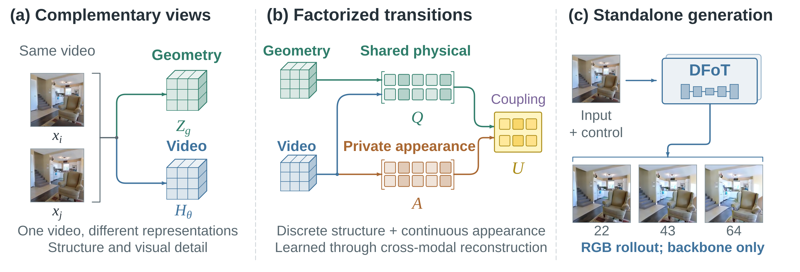
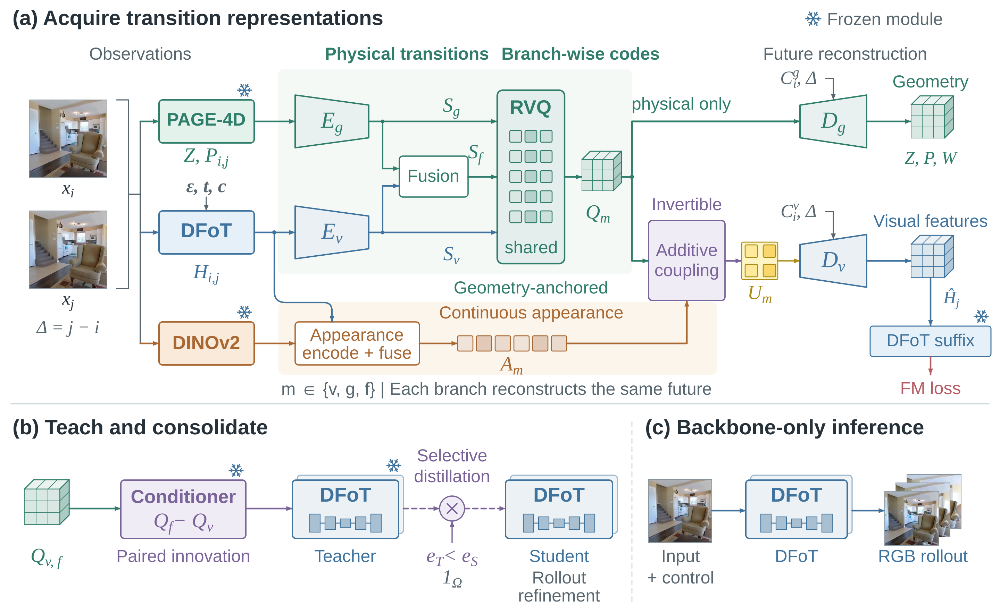

<div align="center">

# UPCAST

### Learning Factorized World Transitions for Geometry-Aware Video World Models

[Project Page](https://upcast-anon.github.io/)

</div>

## Overview



**UPCAST** stands for **Unified Physical and Complementary Appearance State
Transitions**. It learns shared discrete physical transitions and private
continuous appearance transitions, consolidates useful corrections into the
video backbone, and refines autoregressive generation using generated history.
Inference uses the original backbone alone.

<details>
<summary>Method overview</summary>



Representation acquisition combines video and geometry evidence in a shared
physical codebook while retaining complementary appearance. A conditional
teacher guides selective backbone consolidation; the auxiliary representation
and conditioner are not used at deployment.

</details>

## Setup

Use Python 3.10 and a CUDA-compatible PyTorch installation. The source checks
use PyTorch 2.5.0 and torchvision 0.20.0.

```bash
conda create -n upcast python=3.10 -y
conda activate upcast
python -m pip install -r requirements.txt
bash scripts/setup_external.sh
bash scripts/download_baseline_checkpoints.sh
bash scripts/download_teacher_assets.sh
hf download zhouk777/PAGE4D --include checkpoint_nomask.pt --local-dir huggingface/zhouk777--PAGE4D
```

Run commands from the repository root. Logging is offline by default; online
W&B logging requires your own entity. Scripts accept `PYTHON` to select an
interpreter. Download scripts retrieve upstream baseline and teacher assets;
UPCAST checkpoint download links are not yet included in this source release.

## Data

| Dataset | Preparation |
| --- | --- |
| RealEstate10K | Use the [DFoT data format](https://github.com/kwsong0113/diffusion-forcing-transformer/wiki/Dataset) under `data/real-estate-10k`; configure `dataset.save_dir` for another location. |
| ARKitScenes | `scripts/download_arkitscenes.sh` and `evaluation/prepare_arkitscenes.py` prepare synchronized RGB-D clips. The evaluation pipeline runs both steps automatically. |
| Minecraft | Use the DFoT quickstart split with 10 training and 10 validation trajectories under `action_eval_assets/data/minecraft`. |

Datasets, teacher assets, and checkpoints are obtained separately under their
original terms.

## Training

Acquisition uses three recipes, followed by consolidation and rollout
refinement. Replace checkpoint paths below with the corresponding stage outputs.

```bash
ACCUM=10 python -m main +name=UPCAST_acquire dataset=realestate10k algorithm=dfot_upcast recipe=acquire @diffusion/continuous hydra.run.dir=output/train/acquire
ACCUM=2 python -m main +name=UPCAST_adapter dataset=realestate10k algorithm=dfot_upcast recipe=rollout_adapter @diffusion/continuous 'load="/path/to/acquired.ckpt"' hydra.run.dir=output/train/adapter
ACCUM=10 python -m main +name=UPCAST_joint dataset=realestate10k algorithm=dfot_upcast recipe=selective_joint @diffusion/continuous 'load="/path/to/adapter.ckpt"' algorithm.alignment.unit_full_teacher_checkpoint=/path/to/acquired.ckpt algorithm.alignment.video_prior_checkpoint=/path/to/adapter.ckpt hydra.run.dir=output/train/joint

START_CKPT=/path/to/unified.ckpt bash scripts/train_consolidation.sh
START_CKPT=/path/to/consolidated.ckpt TEACHER_CKPT=/path/to/conditional_teacher.ckpt bash scripts/refine_rollout.sh
```

The acquisition recipes use 1,000, 200, and 250 steps. Consolidation uses
150/800/250 steps for warmup, teacher fitting, and student training; final
refinement uses 150 steps. Adjust gradient accumulation for your GPU count to
retain effective batch 40 (8 for the rollout adapter). Historical tensor keys
remain compatible with existing weights; acquisition saves the current schema
with an initially inactive state adapter.

Baseline training uses `scripts/train_representation_baselines.sh`.
Download its teacher assets with `scripts/download_representation_baseline_assets.sh`.
Action-conditioned adaptation uses `scripts/train_action_model.sh`.

## Generation and Evaluation

```bash
EVAL_CKPT=/path/to/upcast.ckpt bash scripts/eval_upcast.sh
EVAL_CKPT=/path/to/upcast.ckpt N_FRAMES=256 bash scripts/eval_upcast.sh

OURS_CKPT=/path/to/upcast.ckpt METHODS=Ours RUN_METRICS=false bash scripts/run_main_experiments.sh
METHODS=Ours bash scripts/run_main_metrics.sh

OURS_CKPT=/path/to/upcast.ckpt METHODS=GF,Ours bash scripts/run_arkitscenes_evaluation.sh
PROBE_CKPT=/path/to/unified.ckpt bash scripts/run_transition_probes.sh
SHARED_SPACE_CKPT=/path/to/unified.ckpt DISTILL_CKPT=/path/to/consolidated.ckpt bash scripts/run_training_stage_analysis.sh
```

The main evaluation generates 100 matched 64-frame videos and a separate
12-video 256-frame cohort. The 128-frame scores use prefixes of the 256-frame
videos. Generation uses one conditioning frame, frame skip 1, a 16-frame
sliding window with four-frame overlap, and backbone-only inference. Raw outputs
retain reference pairing.

To compare all five methods, set `METHODS=DFoT,REPA,VideoREPA,GF,Ours` and provide
`DFOT_CKPT`, `REPA_CKPT`, `VIDEOREPA_CKPT`, `GF_CKPT`, and `OURS_CKPT`.
Metrics are FVD, FID, LPIPS, SSIM, PSNR, official JEDi, and DROID reprojection
error. ARKitScenes reports RGB fidelity, depth, scale drift, normals,
sensor-referenced point clouds, and sensor-anchored pose recall.

JEDi requires its published probe assets and an evaluation environment prepared
with `scripts/setup_jedi_env.sh`; set `JEDI_PYTHON` accordingly. DROID requires
its [CUDA extensions and weights](https://github.com/princeton-vl/DROID-SLAM);
use `RPE_PYTHON` and place `droid.pth` in
`evaluation/reprojection_error/checkpoints/`. Minecraft evaluation is available
through `scripts/run_action_conditioned_eval_pipeline.sh`.
For probes, retain the training run's `.hydra/config.yaml` beside its checkpoints
or provide it with `PROBE_CONFIG`.

## Code Structure

| Directory | Contents |
| --- | --- |
| `upcast/` | Factorized transitions, frozen teachers, and representation objectives |
| `algorithms/dfot/` | Video backbone, conditioning, and consolidation |
| `configurations/` | Model settings and final training recipes |
| `datasets/` | Video and synchronized RGB-D loading |
| `evaluation/` | Paper metrics and transition-space probes |
| `scripts/` | Training, generation, and evaluation entry points |
| `tests/` | Focused CPU checks |

Run `python -m pytest -q tests` for source checks. They do not download model
weights or repeat full GPU training and evaluation.

## License

UPCAST additions use Apache 2.0. Third-party components retain their original
licenses; see [LICENSE](LICENSE), [NOTICE](NOTICE), and
[THIRD_PARTY.md](THIRD_PARTY.md). Model weights and datasets have separate terms.

This repo is forked from [Boyuan Chen](https://boyuan.space/)'s research template
[repo](https://github.com/buoyancy99/research-template). By its license,
you must keep the above sentence in `README.md` and the `LICENSE` file to
credit the author.
